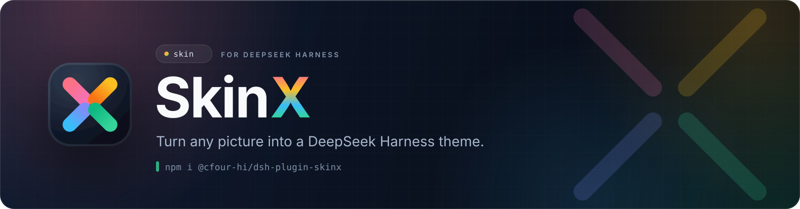
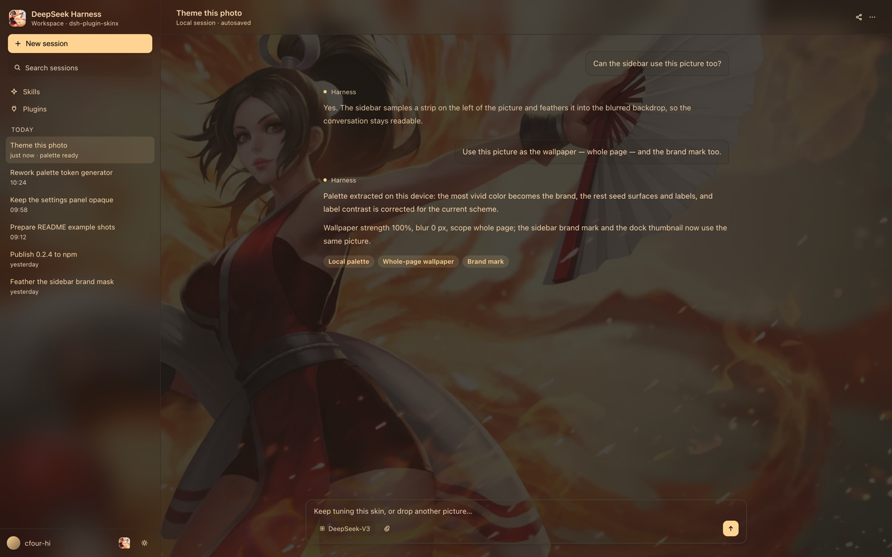
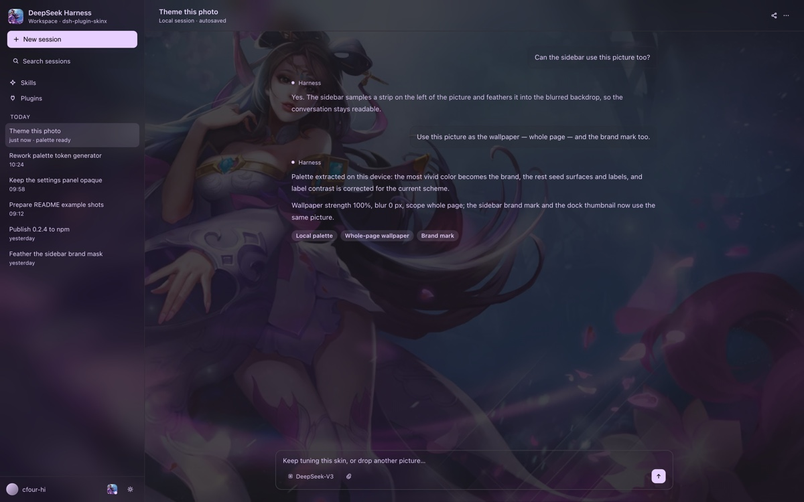
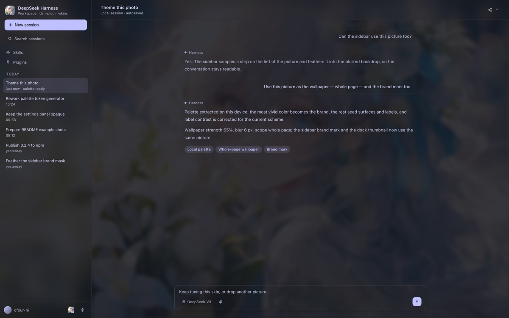
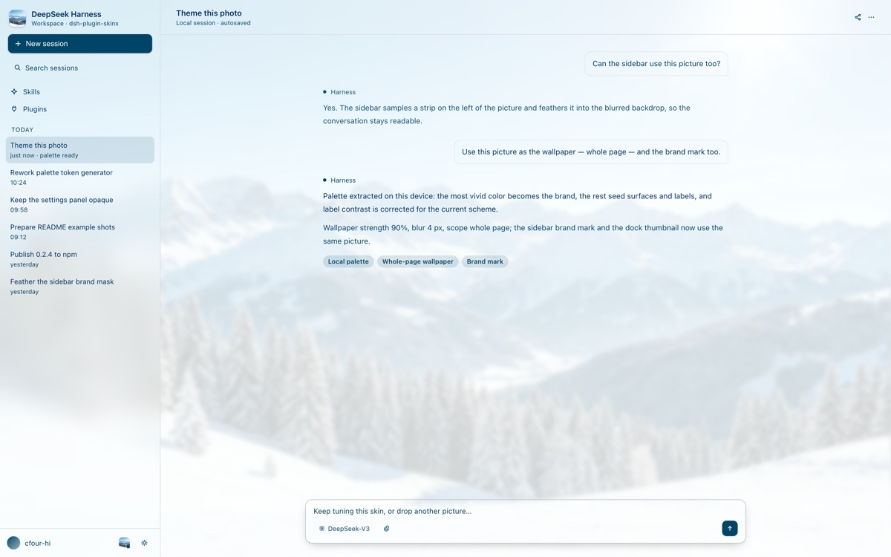
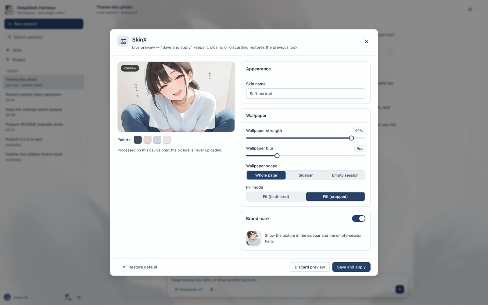
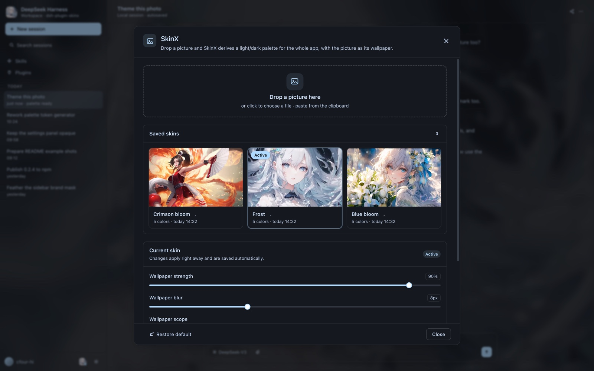

<p align="center">
  
</p>

<p align="center">
  <a href="README.md">简体中文</a> · <strong>English</strong>
</p>

<p align="center">
  <a href="https://github.com/cfour-hi/dsh-plugin-skinx/actions/workflows/ci.yml"></a>
  <a href="https://www.npmjs.com/package/@cfour-hi/dsh-plugin-skinx"></a>
  <a href="https://github.com/cfour-hi/dsh-plugin-skinx/blob/main/package.json">= 20" src="https://img.shields.io/badge/node-%3E%3D20-339933?logo=nodedotjs&amp;logoColor=white&amp;style=flat-square"></a>
  <a href="https://github.com/cfour-hi/dsh-plugin-skinx/blob/main/LICENSE"></a>
  <a href="https://github.com/cfour-hi/dsh-plugin-skinx/commits/main"></a>
  
</p>

SkinX reads an image, extracts a palette locally, derives light/dark values for
theme tokens (surfaces, text, borders, brand, state, sidebar), and uses the same
picture as a wallpaper, a brand mark, and a dock thumbnail.

## Examples

One picture is the wallpaper, the brand mark, and the source of the palette.
Every shot below is rendered locally by the plugin's own palette and token code;
click one to open the full-size image.

<p align="center">
  <a href="docs/examples/wallpaper.en.jpg"></a>
</p>

<p align="center"><sub><strong>Crimson bloom</strong> · whole-page wallpaper · sidebar brand mark · dock thumbnail (dark)</sub></p>

<p align="center">
  <a href="docs/examples/skin-1.en.jpg"></a>
  <a href="docs/examples/skin-2.en.jpg"></a>
  <a href="docs/examples/skin-3.en.jpg"></a>
</p>

<p align="center"><sub><strong>Violet night</strong> (dark) · <strong>Blue bloom</strong> (dark) · <strong>Snowy peak</strong> (light) — one layout, three color temperatures</sub></p>

<p align="center">
  <a href="docs/examples/preview.en.jpg"></a>
  <a href="docs/examples/saved.en.jpg"></a>
</p>

<p align="center"><sub>Live preview after dropping a picture: palette, strength, blur, scope and fill mode · Saved skins: click a cover to apply, click the name to rename, hover to delete</sub></p>

The images live in `docs/examples/`, the source pictures in
`docs/examples/source/`, and both are regenerated by `pnpm run docs:shots` in
headless Chrome (the host shell around the dialog is an illustrative layout,
while the palette, wallpaper and dialog styling come from the plugin).

## What it does

- **One picture → a readable theme.** The palette is extracted automatically
  and turned into light/dark themes that follow the system preference.
- **No palette picker.** The most vivid color in the picture becomes the brand
  color and the rest of the palette seeds surfaces and labels; contrast is
  corrected per theme, so text stays readable over any wallpaper.
- **Wallpaper.** The same picture shows through as a wallpaper; strength, blur,
  fit, and scope (whole page / sidebar / empty-session hero) are adjustable.
- **Brand marks and thumbnails.** The picture also fills the sidebar brand mark
  and the blank-session hero mark, and appears as a thumbnail in the dock button
  and the saved-skin list.
- **Drag, paste, or pick.** Drop a picture anywhere outside a text editor to
  open the dialog with a live preview; pasting and file picking also work inside
  the dialog.
- **Saved skins.** Click a cover to apply, click its name to rename, hover to
  delete, and restore the default in one click; the active skin returns on the
  next launch.
- **Local-only.** Decoding, palette extraction, and encoding happen in the
  page; nothing is uploaded and no model is called.

For implementation details on readability protection, the palette algorithm and
the regression matrix, see [CONTRIBUTING.en.md](CONTRIBUTING.en.md).

## Use

1. Click the SkinX icon beside Settings at the sidebar foot (it shows the
   active picture once a skin is applied).
2. Drop a picture onto the page or the dialog (or pick a file, or paste while
   the dialog is open).
3. Tune the name, wallpaper scope/strength/blur, and brand mark.
4. **Save and apply**.
5. Reopen the dialog to switch skins (click the picture), rename one in place,
   tune the active skin, or restore the default.

## Install

```bash
npm install @cfour-hi/dsh-plugin-skinx
```

Then install the bundle in the running Harness:

```
plugin_manager(action: "install_bundle", target: "@cfour-hi/dsh-plugin-skinx")
```

New versions are published to npm from a `v*` tag by GitHub Actions. Installing
from a local checkout, development commands and the release process live in
[CONTRIBUTING.en.md](CONTRIBUTING.en.md).

## Data and privacy

- Skin definitions live in `${DSH_HOME:-~/.dsh}/skinx/skins.json`; wallpapers
  live in `.../skinx/backgrounds/`.
- The Host half serves them under `/skinx/api` behind the shipped Connection
  trust fence, so only the page's own session can read or write them.
- Images are resized to at most 1600 px and re-encoded as WebP/JPEG before
  they are stored.

## Known limits

- Palette extraction is algorithmic, not semantic: SkinX only reads colors and
  does not recognize "this is a sunset". Very low-contrast or monochrome
  pictures fall back to a neutral tint.
- Only surfaces painted with theme tokens let the wallpaper through; host areas
  with hard-coded colors stay opaque.
- Local wallpaper scopes (sidebar / hero) are mask approximations rather than
  effects applied to those containers directly.
- Enabling the brand mark replaces the shipped sidebar brand while a skin is
  active.
- One skin is active globally; per-session skins and the Appearance theme
  picker are not part of this version.

More implementation notes: [CONTRIBUTING.en.md](CONTRIBUTING.en.md).
