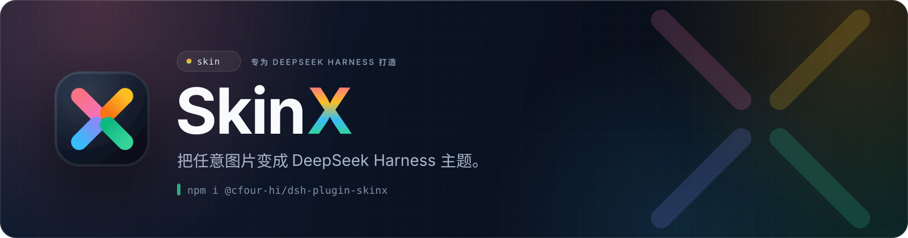
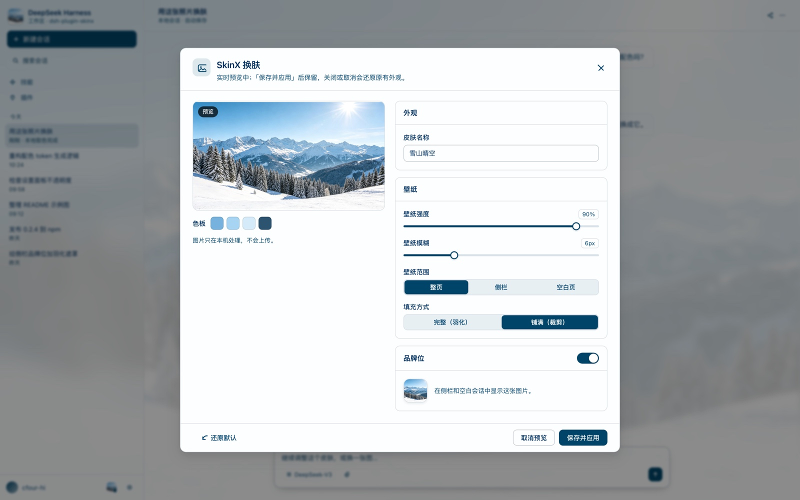
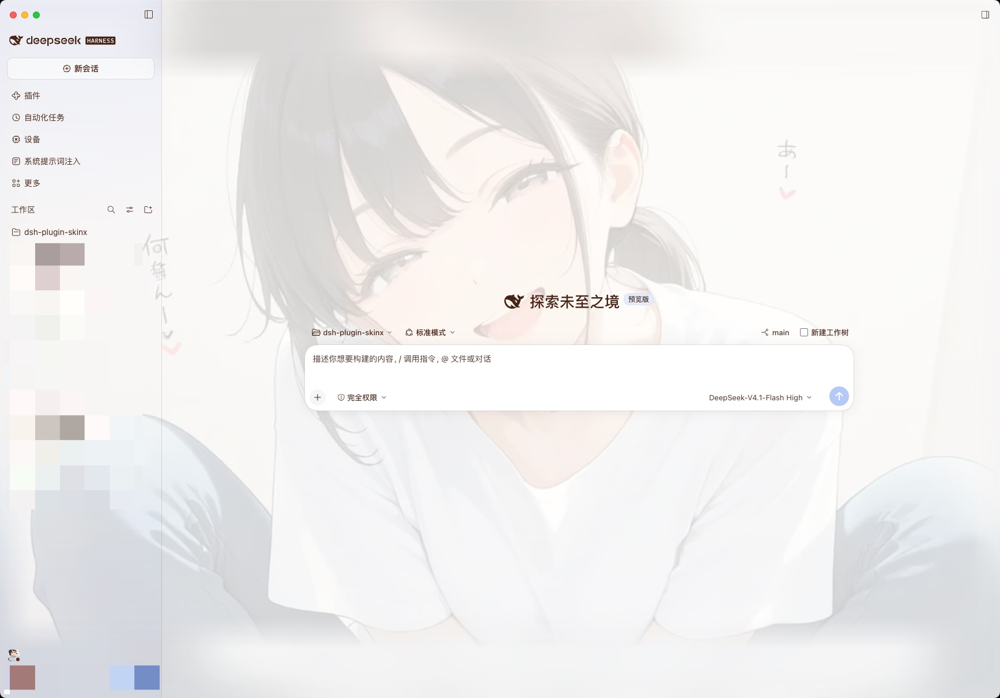
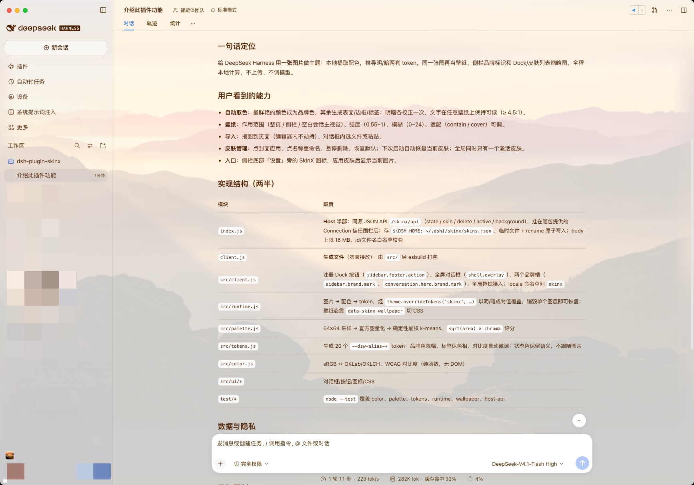
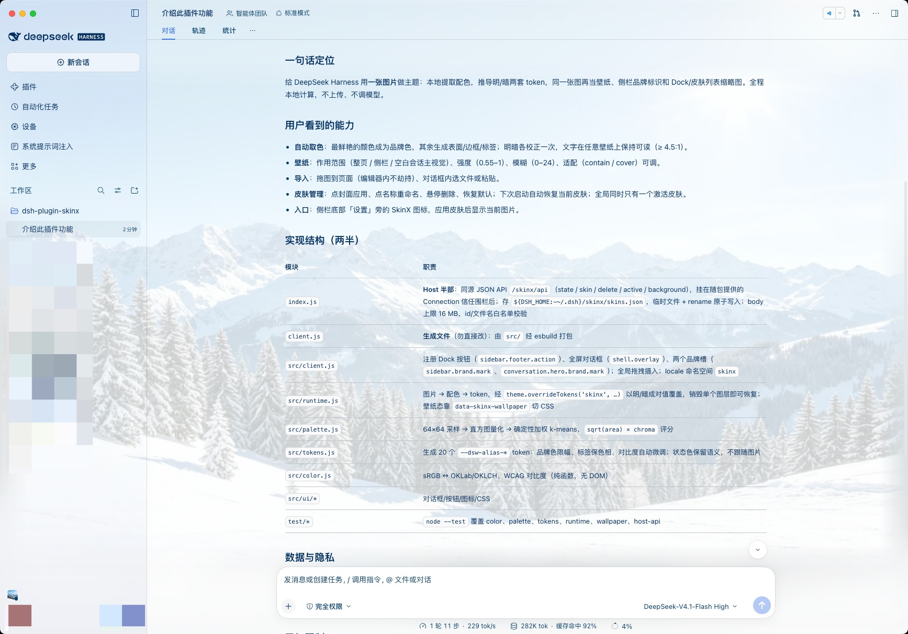

<p align="center">
  
</p>

<p align="center">
  <strong>简体中文</strong> · <a href="README.en.md">English</a>
</p>

<p align="center">
  <a href="https://github.com/cfour-hi/dsh-plugin-skinx/actions/workflows/ci.yml"></a>
  <a href="https://www.npmjs.com/package/@cfour-hi/dsh-plugin-skinx"></a>
  <a href="https://github.com/cfour-hi/dsh-plugin-skinx/blob/main/package.json">= 20" src="https://img.shields.io/badge/node-%3E%3D20-339933?logo=nodedotjs&amp;logoColor=white&amp;style=flat-square"></a>
  <a href="https://github.com/cfour-hi/dsh-plugin-skinx/blob/main/LICENSE"></a>
  <a href="https://github.com/cfour-hi/dsh-plugin-skinx/commits/main"></a>
  
</p>

SkinX 读取一张图片，在本地提取配色，推导明暗两套主题 token（表面、文字、边框、品牌色、状态色、侧边栏），并把同一张图片用作壁纸、品牌标识和 Dock 缩略图。

## 示例

同一张图片既是壁纸、品牌位，也是整套配色的来源。下面所有截图都由插件自身的取色与 token 代码在本地渲染，点开可看原图。

<p align="center">
  <a href="docs/examples/preview.zh.jpg"></a>
</p>

<p align="center">
  <a href="docs/examples/wallpaper.jpg"></a>
</p>

<p align="center">
  <a href="docs/examples/skin-1.jpg"></a>
  <a href="docs/examples/skin-2.jpg"></a>
</p>

示例图存放在 `docs/examples/`，源图在 `docs/examples/source/`，用 `pnpm run docs:shots` 在无头 Chrome 中重新生成（截图里的宿主界面是示意布局，配色、壁纸与对话框样式都来自插件本身）。

## 功能

- **一张图片 → 一套可读的主题。** 自动提取图片配色，生成明/暗两套主题，跟随系统的明暗偏好切换。
- **无需取色器。** 图片中最鲜艳的颜色成为品牌色，其余配色用于生成表面与标签；每个主题单独校正对比度，文字在任意壁纸上都保持可读。
- **壁纸。** 同一张图片作为壁纸透出，强度、模糊、适配方式和作用范围（整页 / 侧边栏 / 空白会话主视觉）均可调整。
- **品牌标识与缩略图。** 图片还会填充侧边栏品牌标识和空白会话主视觉，并作为 Dock 按钮、已保存皮肤列表的缩略图。
- **拖拽、粘贴或选文件导入。** 在文本编辑器之外拖入图片即可打开对话框实时预览；对话框内也可粘贴或选择文件。
- **已保存的皮肤。** 点击封面应用、点击名称重命名、悬停删除、一键恢复默认；下次启动自动恢复当前皮肤。
- **仅本地处理。** 解码、配色提取和编码都在页面内完成，不上传网络服务，也不调用模型。

可读性保护、配色算法与回归矩阵的实现细节见 [CONTRIBUTING.md](CONTRIBUTING.md)。

## 使用

1. 点击侧边栏底部“设置”旁的 SkinX 图标（应用皮肤后，图标会显示当前图片）。
2. 将图片拖到页面或对话框上（也可以选择文件，或在对话框打开时粘贴）。
3. 调整名称、壁纸范围/强度/模糊和品牌标识。
4. **保存并应用**。
5. 重新打开对话框即可切换皮肤（点击图片）、原地重命名、调整当前皮肤，或恢复默认。

## 安装

```bash
npm install @cfour-hi/dsh-plugin-skinx
```

然后在运行中的 Harness 里安装 bundle：

```
plugin_manager(action: "install_bundle", target: "@cfour-hi/dsh-plugin-skinx")
```

新版本通过 `v*` 标签由 GitHub Actions 自动发布到 npm。从本地检出安装、开发命令与发布流程见 [CONTRIBUTING.md](CONTRIBUTING.md)。

## 数据与隐私

- 皮肤定义保存在 `${DSH_HOME:-~/.dsh}/skinx/skins.json`；壁纸保存在 `.../skinx/backgrounds/`。
- Host 端通过随包提供的 Connection 信任机制在 `/skinx/api` 下提供这些数据，只有页面自身会话可以读写。
- 图片在存储前会缩放到最大 1600 px，并重新编码为 WebP/JPEG。

## 已知限制

- 配色提取是算法式的，不是语义式的：SkinX 只读取颜色，无法识别“这是一张日落照片”。对比度极低或单色的图片会回退为中性色调。
- 只有使用主题 token 绘制的表面才会透出壁纸；宿主中写死颜色的区域仍保持不透明。
- 侧边栏 / 主视觉等局部壁纸是遮罩近似效果，不是精确作用于对应容器。
- 启用品牌标识后，皮肤激活期间会替换内置侧边栏品牌标识。
- 同一时间全局只有一个激活皮肤；暂不支持按会话切换皮肤，也不接入 Appearance 主题选择器。

更多实现注记见 [CONTRIBUTING.md](CONTRIBUTING.md)。
